# Arquitetura do Sistema — Marketplace de Brechós

## 1. Visão Geral

O **Marketplace de Brechós** é desenvolvido em Java 21 gerenciado por Maven, seguindo a metodologia **Spec-Driven Development (SDD)**.

A arquitetura separa claramente as camadas de **Apresentação (`Main`)**, **Controle/Fachada (`controller`)**, **Negócio (`service`, `validator`, `repository`, `factory`, `model`)** e **Infraestrutura (`infra.persistence.ram`, `infra.persistence.sqlite`, `infra.factory`, `infra.log`)**.

---

# 2. Arquitetura em Camadas (`Business` vs `Infra`)

```text
┌───────────────────────────────────────────────────────────────────┐
│                         APRESENTAÇÃO (CLI)                        │
│                              mtd.Main                             │
└─────────────────────────────────┬─────────────────────────────────┘
                                  │
                                  ▼
┌───────────────────────────────────────────────────────────────────┐
│               CAMADA DE CONTROLE (Facade + Singleton)             │
│                  mtd.controller.FacadeSingletonController         │
└───────────┬─────────────────────┼─────────────────────┬───────────┘
            │                     │                     │
            ▼                     ▼                     ▼
┌─────────────────────┐ ┌───────────────────┐ ┌─────────────────────┐
│   CAMADA BUSINESS   │ │  CAMADA BUSINESS  │ │   CAMADA BUSINESS   │
│   UsuarioService    │ │  ProdutoService   │ │   Template Method   │
│ + UsuarioValidator  │ │ + ProdutoValidator│ │ RelatorioAcessoHTML │
│                     │ │                   │ │ RelatorioAcessoPDF  │
└───────────┬─────────┘ └─────────┬─────────┘ └─────────────────────┘
            │                     │
            ▼                     ▼
┌───────────────────────────────────────────┐ ┌─────────────────────┐
│        CONTRATOS DE NEGÓCIO (Interfaces)  │ │   ADAPTER TARGET    │
│    UsuarioRepository / ProdutoRepository  │ │      AppLogger      │
│             RepositoryFactory             │ └──────────┬──────────┘
└─────────────────────┬─────────────────────┘            │
                      │                                  ▼
                      ▼                       ┌─────────────────────┐
┌───────────────────────────────────────────┐ │    CAMADA INFRA     │
│        CAMADA INFRA (Persistência)        │ │JavaUtilLoggerAdapter│
│  RamRepositoryFactory / SQLiteRepoFactory │ │  (Adaptee: Logger)  │
│  UsuarioRepositoryRam / SQLite            │ └─────────────────────┘
│  ProdutoRepositoryRAM / SQLite            │
└───────────────────────────────────────────┘
```

---

# 3. Catálogo de Padrões de Projeto Utilizados no Sistema

| # | Padrão de Projeto | Categoria | Classes Participantes no Projeto | Papel / Justificativa Arquitetural |
|---|---|---|---|---|
| **1** | **Singleton** | Criacional (GoF) | `FacadeSingletonController` | Garante instância única e *thread-safe* (*Double-Checked Locking* com `volatile`) do controlador central da aplicação. |
| **2** | **Facade** | Estrutural (GoF) | `FacadeSingletonController` | Unifica o acesso a `UsuarioService`, `ProdutoService`, geração de relatórios (`RelatorioEstatisticaAcessoTemplate`) e métricas globais (`getQuantidadeTotalEntidadesCadastradas()`). |
| **3** | **Repository** | Arquitetural / Persistência | `UsuarioRepository`, `ProdutoRepository` (Contratos)<br>`UsuarioRepositoryRam`, `ProdutoRepositoryRAM`, `UsuarioRepositorySQLite`, `ProdutoRepositorySQLite` (`infra`) | Isola a camada `business` dos detalhes de armazenamento em memória (`ConcurrentHashMap`) ou banco relacional (`SQLite`). |
| **4** | **Abstract Factory & Factory Method** | Criacional (GoF) | `RepositoryFactory` (*Abstract Factory + Factory Method* `selecionarFactory`), `RamRepositoryFactory`, `SQLiteRepositoryFactory` (*Concrete Factories*), `EntityFactory` (*Factory Method*) | Cria famílias de repositórios compatíveis (`RAM` ou `SQLite`) e instancia entidades (`Usuario`, `Produto`) sem acoplar o cliente às classes concretas de `infra`. |
| **5** | **Adapter** | Estrutural (GoF) | `AppLogger` (*Target*), `JavaUtilLoggerAdapter` (*Adapter*), `java.util.logging.Logger` (*Adaptee*) | Converte a interface da biblioteca de log externa (`java.util.logging.Logger`) para o contrato de domínio `AppLogger` consumido pelos `Services`. |
| **6** | **Template Method** | Comportamental (GoF) | `RelatorioEstatisticaAcessoTemplate` (*AbstractClass*), `RelatorioAcessoHTML`, `RelatorioAcessoPDF` (*ConcreteClasses*) | Define o esqueleto fixo (`final gerarRelatorio`) do cálculo de estatísticas de acesso dos usuários, delegando a formatação de cabeçalho, corpo e rodapé para as subclasses `HTML` e `PDF`. |

---

# 4. Diagrama de Classes Completo com Identificação dos Padrões de Projeto (Mermaid)

```mermaid
classDiagram
    direction TB

    %% ==========================================
    %% FRONTEIRA / CLIENTE
    %% ==========================================
    class Main {
        <<Fronteira / Client>>
        +main(String[] args)$ void
        -tentarAdicionarUsuario(FacadeSingletonController, Usuario)$ void
        -tentarCadastrarProduto(FacadeSingletonController, Produto)$ void
    }

    %% ==========================================
    %% PADROES FACADE + SINGLETON
    %% ==========================================
    class FacadeSingletonController {
        <<Facade / Singleton>>
        -instance : FacadeSingletonController$
        -usuarioService : UsuarioService
        -produtoService : ProdutoService
        -FacadeSingletonController(UsuarioService, ProdutoService)
        +getInstance(UsuarioService, ProdutoService)$ FacadeSingletonController
        +getInstance(RepositoryFactory)$ FacadeSingletonController
        +getInstance(String modo)$ FacadeSingletonController
        +getInstance()$ FacadeSingletonController
        +adicionarUsuario(Usuario usuario) void
        +buscarUsuarioPorId(int id) Optional~Usuario~
        +listarTodosUsuarios() List~Usuario~
        +atualizarUsuario(Usuario usuario) void
        +deletarUsuario(int id) void
        +registrarAcessoUsuario(int id) void
        +cadastrarProduto(Produto produto) Produto
        +buscarProdutoPorId(Long id) Optional~Produto~
        +listarTodosProdutos() List~Produto~
        +atualizarProduto(Produto produto) void
        +deletarProduto(Long id) void
        +getQuantidadeTotalEntidadesCadastradas() int
        +gerarRelatorioEstatisticaAcesso(RelatorioEstatisticaAcessoTemplate) String
        +gerarRelatorioAcessoHTML() String
        +gerarRelatorioAcessoPDF() String
    }

    %% ==========================================
    %% PADRAO ABSTRACT FACTORY & FACTORY METHOD
    %% ==========================================
    class RepositoryFactory {
        <<AbstractFactory / FactoryMethod>>
        +criarUsuarioRepository() UsuarioRepository
        +criarProdutoRepository() ProdutoRepository
        +selecionarFactory(String modo)$ RepositoryFactory
    }

    class RamRepositoryFactory {
        <<ConcreteFactory>>
        +criarUsuarioRepository() UsuarioRepository
        +criarProdutoRepository() ProdutoRepository
    }

    class SQLiteRepositoryFactory {
        <<ConcreteFactory>>
        +criarUsuarioRepository() UsuarioRepository
        +criarProdutoRepository() ProdutoRepository
    }

    class EntityFactory {
        <<FactoryMethod>>
        +criarUsuario(int id, String nome, String email, String senha)$ Usuario
        +criarProduto(Long id, String titulo, String descricao, BigDecimal preco, String tamanho, Long usuarioId)$ Produto
    }

    %% ==========================================
    %% CAMADA BUSINESS (SERVICES & VALIDATORS)
    %% ==========================================
    class UsuarioService {
        <<Controle / Business>>
        -usuarioRepository : UsuarioRepository
        -usuarioValidator : UsuarioValidator
        -logger : AppLogger
        +adicionarUsuario(Usuario usuario) void
        +buscarPorId(int id) Optional~Usuario~
        +listarTodosUsuarios() List~Usuario~
        +atualizarUsuario(Usuario usuario) void
        +deletarUsuario(int id) void
        +registrarAcesso(int usuarioId) void
        +contarUsuarios() int
    }

    class ProdutoService {
        <<Controle / Business>>
        -produtoRepository : ProdutoRepository
        -produtoValidator : ProdutoValidator
        -logger : AppLogger
        +cadastrarProduto(Produto produto) Produto
        +buscarPorId(Long id) Optional~Produto~
        +listarTodosProdutos() List~Produto~
        +atualizarProduto(Produto produto) void
        +deletarProduto(Long id) void
        +contarProdutos() int
    }

    class UsuarioValidator {
        <<Controle / Validator>>
        +validar(Usuario usuario) void
        +validarNome(String nome) void
        +validarSenha(String senha, String nome, String email) void
    }

    class ProdutoValidator {
        <<Controle / Validator>>
        +validar(Produto produto) void
        +validarTitulo(String titulo) void
        +validarPreco(BigDecimal preco) void
    }

    %% ==========================================
    %% PADRAO TEMPLATE METHOD (RELATORIOS DE ACESSO)
    %% ==========================================
    class RelatorioEstatisticaAcessoTemplate {
        <<TemplateMethod / AbstractClass>>
        +gerarRelatorio(List~Usuario~ usuarios, int totalProdutos) String
        -calcularTotalAcessos(List~Usuario~ usuarios) int
        -identificarUsuarioMaisAtivo(List~Usuario~ usuarios) String
        #montarCabecalho(String titulo, String dataHoraGeracao)* String
        #montarCorpoEstatisticas(int totalUsuarios, int totalAcessos, double mediaAcessos, String usuarioMaisAtivo, List~Usuario~ usuarios)* String
        #montarRodape(int totalEntidades)* String
    }

    class RelatorioAcessoHTML {
        <<TemplateMethod / ConcreteClass>>
        #montarCabecalho(String titulo, String dataHoraGeracao) String
        #montarCorpoEstatisticas(int, int, double, String, List~Usuario~) String
        #montarRodape(int totalEntidades) String
    }

    class RelatorioAcessoPDF {
        <<TemplateMethod / ConcreteClass>>
        #montarCabecalho(String titulo, String dataHoraGeracao) String
        #montarCorpoEstatisticas(int, int, double, String, List~Usuario~) String
        #montarRodape(int totalEntidades) String
    }

    %% ==========================================
    %% PADRAO ADAPTER (LOGGING)
    %% ==========================================
    class AppLogger {
        <<Adapter Target>>
        +info(String operacao, String mensagem) void
        +aviso(String operacao, String mensagem) void
        +erro(String operacao, String mensagem, Throwable causa) void
    }

    class JavaUtilLoggerAdapter {
        <<Adapter>>
        -adaptee : Logger
        +info(String operacao, String mensagem) void
        +aviso(String operacao, String mensagem) void
        +erro(String operacao, String mensagem, Throwable causa) void
    }

    class JavaUtilLogger {
        <<Adaptee : java.util.logging.Logger>>
        +log(Level level, String msg) void
    }

    %% ==========================================
    %% PADRAO REPOSITORY (CONTRATOS E INFRA)
    %% ==========================================
    class UsuarioRepository {
        <<Repository Interface>>
        +adicionar(Usuario usuario) void
        +buscarPorId(int id) Optional~Usuario~
        +listarTodos() List~Usuario~
        +atualizar(Usuario usuario) void
        +deletar(int id) void
        +contar() int
    }

    class UsuarioRepositoryRam {
        <<Repository Infra RAM>>
        -usuarios : Map~Integer, Usuario~
        +adicionar(Usuario usuario) void
        +buscarPorId(int id) Optional~Usuario~
        +listarTodos() List~Usuario~
        +atualizar(Usuario usuario) void
        +deletar(int id) void
        +contar() int
    }

    class UsuarioRepositorySQLite {
        <<Repository Infra SQLite>>
        -URL : String$
        +adicionar(Usuario usuario) void
        +buscarPorId(int id) Optional~Usuario~
        +listarTodos() List~Usuario~
        +atualizar(Usuario usuario) void
        +deletar(int id) void
        +contar() int
    }

    class ProdutoRepository {
        <<Repository Interface>>
        +salvar(Produto produto) Produto
        +buscarPorId(Long id) Optional~Produto~
        +listarTodos() List~Produto~
        +atualizar(Produto produto) void
        +deletar(Long id) void
        +contar() int
    }

    class ProdutoRepositoryRAM {
        <<Repository Infra RAM>>
        -produtos : Map~Long, Produto~
        -geradorId : AtomicLong
        +salvar(Produto produto) Produto
        +buscarPorId(Long id) Optional~Produto~
        +listarTodos() List~Produto~
        +atualizar(Produto produto) void
        +deletar(Long id) void
        +contar() int
    }

    class ProdutoRepositorySQLite {
        <<Repository Infra SQLite>>
        -URL : String$
        +salvar(Produto produto) Produto
        +buscarPorId(Long id) Optional~Produto~
        +listarTodos() List~Produto~
        +atualizar(Produto produto) void
        +deletar(Long id) void
        +contar() int
    }

    %% ==========================================
    %% ENTIDADES DE DOMINIO
    %% ==========================================
    class Usuario {
        <<Entidade>>
        -id : int
        -nome : String
        -email : String
        -senha : String
        -quantidadeAcessos : int
        +registrarAcesso() void
        +getQuantidadeAcessos() int
    }

    class Produto {
        <<Entidade>>
        -id : Long
        -titulo : String
        -descricao : String
        -preco : BigDecimal
        -tamanho : String
        -usuarioId : Long
    }

    %% ==========================================
    %% RELACIONAMENTOS
    %% ==========================================
    Main ..> FacadeSingletonController : aciona
    Main ..> EntityFactory : cria entidades com

    FacadeSingletonController *-- "1" UsuarioService : unifica
    FacadeSingletonController *-- "1" ProdutoService : unifica
    FacadeSingletonController ..> RepositoryFactory : obtem repositorios via
    FacadeSingletonController ..> RelatorioEstatisticaAcessoTemplate : gera relatorios via

    RepositoryFactory <|.. RamRepositoryFactory : implements
    RepositoryFactory <|.. SQLiteRepositoryFactory : implements
    RamRepositoryFactory ..> UsuarioRepositoryRam : cria
    RamRepositoryFactory ..> ProdutoRepositoryRAM : cria
    SQLiteRepositoryFactory ..> UsuarioRepositorySQLite : cria
    SQLiteRepositoryFactory ..> ProdutoRepositorySQLite : cria

    EntityFactory ..> Usuario : instancia
    EntityFactory ..> Produto : instancia

    RelatorioEstatisticaAcessoTemplate <|-- RelatorioAcessoHTML : extends
    RelatorioEstatisticaAcessoTemplate <|-- RelatorioAcessoPDF : extends

    UsuarioService --> "1" UsuarioRepository : persiste via
    UsuarioService --> "1" UsuarioValidator : valida com
    UsuarioService --> "1" AppLogger : registra logs via

    ProdutoService --> "1" ProdutoRepository : persiste via
    ProdutoService --> "1" ProdutoValidator : valida com
    ProdutoService --> "1" AppLogger : registra logs via

    AppLogger <|.. JavaUtilLoggerAdapter : implements
    JavaUtilLoggerAdapter --> "1" JavaUtilLogger : adapta (Adaptee)

    UsuarioRepository <|.. UsuarioRepositoryRam : implements
    UsuarioRepository <|.. UsuarioRepositorySQLite : implements
    ProdutoRepository <|.. ProdutoRepositoryRAM : implements
    ProdutoRepository <|.. ProdutoRepositorySQLite : implements

    Usuario "1" <-- "0..*" Produto : pertence a (usuarioId)
```


