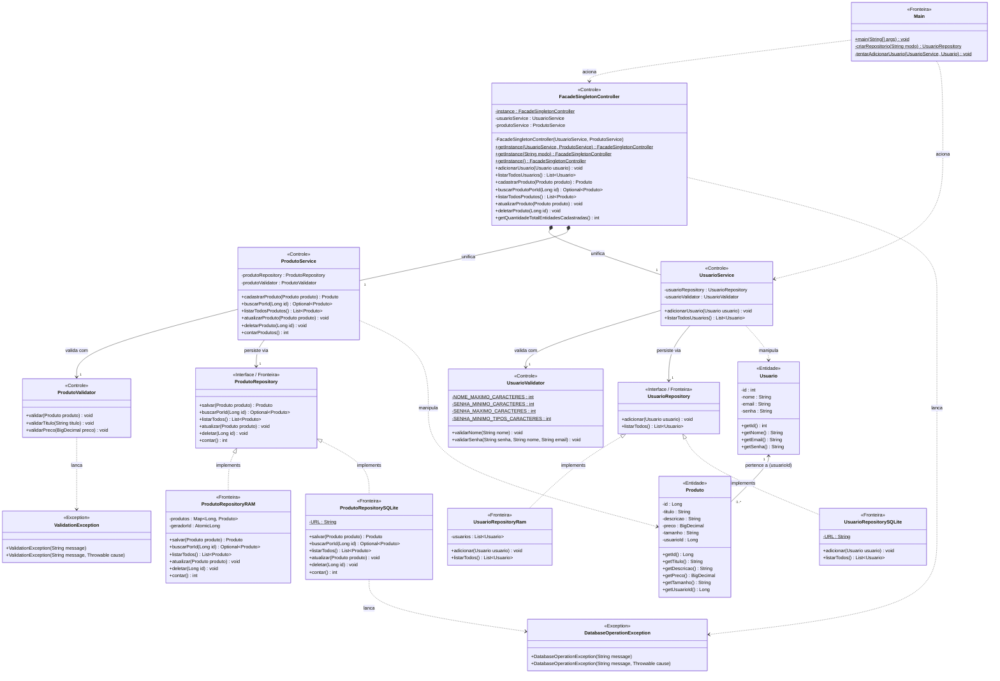

# Arquitetura do Sistema — Marketplace de Brechós

## 1. Visão geral

O Marketplace de Brechós será desenvolvido inicialmente utilizando Java.

A arquitetura do sistema será organizada em camadas, buscando separar as responsabilidades relacionadas à apresentação, regras de negócio, acesso aos dados e entidades do domínio.

A estrutura inicial será preparada para permitir que o armazenamento em memória utilizado durante o desenvolvimento possa posteriormente ser substituído por um banco de dados.

---

# 2. Arquitetura em camadas

O sistema será organizado nas seguintes camadas:

```text
┌───────────────────────────────┐
│          Apresentação         │
│              Main             │
└───────────────┬───────────────┘
                │
                ▼
┌───────────────────────────────┐
│            Service            │
│        Regras de negócio      │
└───────────────┬───────────────┘
                │
                ▼
┌───────────────────────────────┐
│          Repository           │
│       Acesso aos dados        │
└───────────────┬───────────────┘
                │
                ▼
┌───────────────────────────────┐
│             Model             │
│       Entidades do domínio    │
└───────────────────────────────┘
```

---

# 3. Diagrama de Classes de Análise (Fronteira, Controle e Entidade)

O diagrama abaixo modela o sistema seguindo o padrão **BCE (*Boundary, Control, Entity* — Fronteira, Controle e Entidade)**, contemplando os padrões **Singleton** e **Facade** aplicados em `FacadeSingletonController`, a separação de validações (`UsuarioValidator` e `ProdutoValidator`), o tratamento de exceções customizadas (`ValidationException` e `DatabaseOperationException`) e a persistência polimórfica em memória (`RAM`) e banco de dados (`SQLite`).

## 3.1 Responsabilidades por Estereótipo

- **`<<Fronteira>>` (*Boundary*):**
  - **Interface com o Usuário (CLI):** `Main` recebe os parâmetros de execução e exibe os resultados no console.
  - **Interface com Persistência Externa / SGBD:** `UsuarioRepository` e `ProdutoRepository` (e suas implementações `RAM` e `SQLite`) isolam a comunicação com o meio de armazenamento.
- **`<<Controle>>` (*Control*):**
  - **Coordenação Central (Facade + Singleton):** `FacadeSingletonController` unifica o acesso aos serviços de usuário e produto com instanciação *thread-safe* (*double-checked locking*).
  - **Regras de Negócio e Validação:** `UsuarioService`, `ProdutoService`, `UsuarioValidator` e `ProdutoValidator` coordenam os fluxos de negócio e garantem a integridade dos dados através de `ValidationException` e `DatabaseOperationException`.
- **`<<Entidade>>` (*Entity*):**
  - **Domínio:** `Usuario` e `Produto` representam os dados persistentes e o relacionamento entre vendedor/usuário e os itens anunciados no marketplace.

## 3.2 Diagrama UML (Mermaid)


