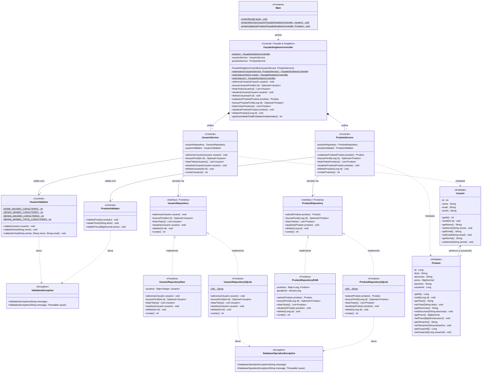

# Arquitetura do Sistema — Marketplace de Brechós

## 1. Visão geral

O Marketplace de Brechós é desenvolvido em Java 21 gerenciado por Maven, seguindo a metodologia **Spec-Driven Development (SDD)**.

A arquitetura do sistema é organizada em camadas desacopladas, separando as responsabilidades de **Apresentação (`Main`)**, **Coordenação de Controle (`FacadeSingletonController`)**, **Regras de Negócio e Validação (`Service` e `Validator`)**, **Persistência Polimórfica (`Repository` RAM/SQLite)** e **Entidades de Domínio (`Model`)**.

---

# 2. Arquitetura em camadas (Até a Sprint 3)

O sistema encontra-se estruturado nas seguintes camadas:

```text
┌───────────────────────────────────────────┐
│               Apresentação                │
│                   Main                    │
└─────────────────────┬─────────────────────┘
                      │
                      ▼
┌───────────────────────────────────────────┐
│          Controller (Facade/Singleton)    │
│         FacadeSingletonController         │
└──────────┬─────────────────────┬──────────┘
           │                     │
           ▼                     ▼
┌─────────────────────┐ ┌───────────────────┐
│   UsuarioService    │ │  ProdutoService   │
│ + UsuarioValidator  │ │ + ProdutoValidator│
└──────────┬──────────┘ └────────┬──────────┘
           │                     │
           ▼                     ▼
┌─────────────────────┐ ┌───────────────────┐
│  UsuarioRepository  │ │ ProdutoRepository │
│   (RAM / SQLite)    │ │  (RAM / SQLite)   │
└──────────┬──────────┘ └────────┬──────────┘
           │                     │
           ▼                     ▼
┌─────────────────────┐ ┌───────────────────┐
│       Usuario       │ │      Produto      │
│   (Entidade Model)  │ │  (Entidade Model) │
└─────────────────────┘ └───────────────────┘
```

---

# 3. Diagrama de Classes de Análise (Fronteira, Controle e Entidade — Sprint 3)

O diagrama abaixo modela o sistema até a **Sprint 3** seguindo o padrão de análise **BCE (*Boundary, Control, Entity* — Fronteira, Controle e Entidade)**, contemplando:
- **CRUD completo das duas entidades (`Usuario` e `Produto`)**;
- Padrões de projeto **Singleton** (*thread-safe double-checked locking*) e **Facade** em `FacadeSingletonController`;
- Tratamento padronizado de exceções de domínio (`ValidationException` e `DatabaseOperationException`).

## 3.1 Responsabilidades por Estereótipo

- **`<<Fronteira>>` (*Boundary*):**
  - **Interface com o Usuário (CLI):** `Main` interpreta o modo de inicialização (`ram` ou `bd`), aciona a fachada e apresenta os resultados no console.
  - **Interface com Persistência Externa / SGBD:** `UsuarioRepository` e `ProdutoRepository` (com implementações `RAM` em `ConcurrentHashMap` e `SQLite` via JDBC) isolam a comunicação com o meio de armazenamento.
- **`<<Controle>>` (*Control*):**
  - **Coordenação Central (Facade + Singleton):** `FacadeSingletonController` unifica todas as operações CRUD de `UsuarioService` e `ProdutoService`, além de consolidar métricas (`getQuantidadeTotalEntidadesCadastradas()`).
  - **Regras de Negócio e Validação:** `UsuarioService`, `ProdutoService`, `UsuarioValidator` e `ProdutoValidator` coordenam os fluxos e lançam `ValidationException` quando regras de negócio são violadas.
- **`<<Entidade>>` (*Entity*):**
  - **Domínio:** `Usuario` e `Produto` representam os objetos persistentes do marketplace e seu relacionamento (`1 Usuario` possui `0..* Produto` via `usuarioId`).

## 3.2 Diagrama UML (Mermaid)



---

# 4. Revisões de Código e Melhorias Aplicadas até a Sprint 3

1. **Desacoplamento de Exceções de Infraestrutura (`SQLException` → `DatabaseOperationException`):**
   - Anteriormente, `UsuarioRepository` e `UsuarioService` expunham `throws SQLException` em suas assinaturas, acoplando a camada de negócio à API JDBC mesmo quando executada em memória (`RAM`).
   - Na revisão da Sprint 3, toda `SQLException` lançada em `UsuarioRepositorySQLite` e `ProdutoRepositorySQLite` passou a ser capturada e relançada encapsulada em `DatabaseOperationException`.
2. **Padronização das Exceções de Validação (`ValidationException`):**
   - Tanto `UsuarioValidator` quanto `ProdutoValidator` agora lançam `ValidationException` em caso de violação de regras de negócio (nome vazio/com números/longo, senha fraca/igual ao nome ou e-mail, título vazio ou preço não positivo).
3. **Concorrência Segura em Memória (`ConcurrentHashMap`):**
   - Os repositórios em memória (`UsuarioRepositoryRam` e `ProdutoRepositoryRAM`) utilizam `ConcurrentHashMap`, evitando condições de corrida em acessos concorrentes.
4. **Simetria de Operações CRUD nas Duas Entidades (`Usuario` e `Produto`):**
   - Ambas as entidades contam com operações completas de criação, busca por ID (`Optional`), listagem completa, atualização, remoção e contagem (`contar()`), todas expostas de forma centralizada por `FacadeSingletonController`.
