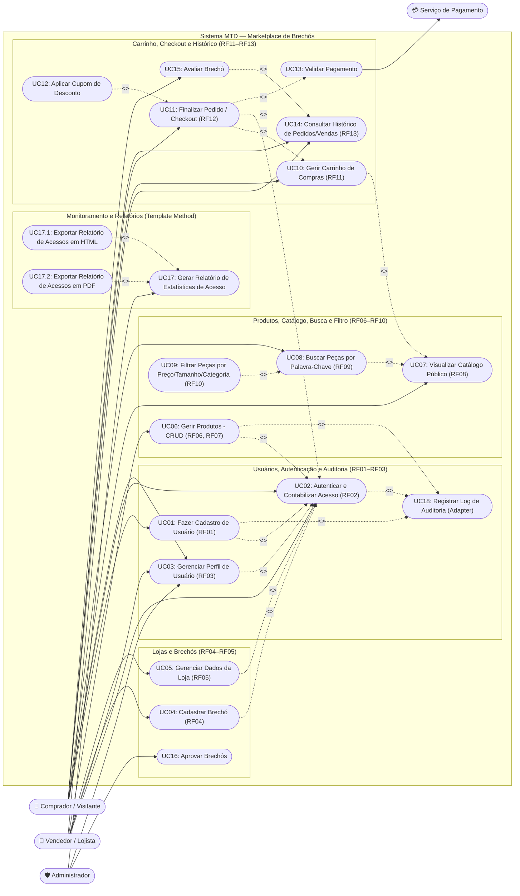

# Casos de Uso — Marketplace de Brechós

## 1. Visão Geral

O **Marketplace de Brechós** é uma plataforma digital destinada à divulgação e comercialização de peças de segunda mão (desapego), aproximando compradores, vendedores/brechós e administradores em um ambiente centralizado.

Conforme especificado em [requisitos-funcionais.md](file:///home/lucas/MTD-marketplace-brechos/docs/requisitos/requisitos-funcionais.md) (**RF01 a RF13**) e nas evoluções arquiteturais do projeto (Persistência Plugável `Repository` + `Abstract Factory`, Auditoria de Logs via `Adapter` e Geração de Relatórios de Acesso via `Template Method`), o sistema contempla os seguintes atores:

- **Comprador / Visitante:** pesquisa no catálogo, aplica filtros, gerencia carrinho, finaliza pedidos e avalia brechós.
- **Vendedor / Lojista:** cadastra e gerencia seu brechó, publica/edita/remove peças de vestuário e consulta suas vendas.
- **Administrador:** aprova brechós, gerencia usuários e emite **relatórios de estatísticas de acesso dos usuários (HTML e PDF)**.
- **Serviço de Pagamento (Ator Secundário/Externo):** processa a validação de pagamentos no checkout.

---

## 2. Matriz de Rastreabilidade (Requisitos × Casos de Uso × Padrões de Projeto)

| Requisito | Título | Caso(s) de Uso Associado(s) | Padrões de Projeto Envolvidos |
|---|---|---|---|
| **RF01** | Cadastro de Usuários (Perfil Único e E-mail Único) | **UC01** — Fazer Cadastro de Usuário | `Facade`, `Singleton`, `Factory Method`, `Repository`, `Adapter (Log)` |
| **RF02** | Autenticação e Registro de Acesso de Usuários | **UC02** — Autenticar Usuário / Registrar Acesso | `Facade`, `Repository`, `Adapter (Log)` |
| **RF03** | Gerenciamento de Perfil (Consulta, Edição e Exclusão) | **UC03** — Gerenciar Perfil de Usuário | `Facade`, `Repository`, `Adapter (Log)` |
| **RF04** | Cadastro de Brechó | **UC04** — Cadastrar Brechó **UC16** — Aprovar Brechós | `Facade`, `Repository` |
| **RF05** | Gerenciamento da Loja / Vitrine do Brechó | **UC05** — Gerenciar Dados da Loja | `Facade`, `Repository` |
| **RF06** | Cadastro de Peças/Produtos | **UC06** — Gerir Produtos (Cadastrar Produto) | `Facade`, `Singleton`, `Factory Method`, `Repository`, `Adapter (Log)` |
| **RF07** | Atualização e Remoção de Produtos | **UC06** — Gerir Produtos (Alterar / Remover Produto) | `Facade`, `Repository`, `Adapter (Log)` |
| **RF08** | Visualização do Catálogo Público (Vitrine) | **UC07** — Visualizar Catálogo Público | `Facade`, `Repository` |
| **RF09** | Pesquisa de Produtos por Palavras-Chave | **UC08** — Buscar Peças por Palavra-Chave | `Facade`, `Repository` |
| **RF10** | Filtragem de Itens (Preço, Tamanho, Categoria, Brechó) | **UC09** — Filtrar Peças | `Facade`, `Repository` |
| **RF11** | Gestão do Carrinho de Compras (Adicionar/Remover) | **UC10** — Gerir Carrinho de Compras | `Facade` |
| **RF12** | Finalização de Pedido (Checkout) | **UC11** — Finalizar Pedido (Checkout) **UC12** — Aplicar Cupom de Desconto **UC13** — Validar Pagamento | `Facade`, `Repository`, `Adapter` |
| **RF13** | Histórico, Status e Estatísticas de Acesso/Pedidos | **UC14** — Consultar Histórico de Pedidos/Vendas **UC15** — Avaliar Brechó **UC17** — Gerar Relatório de Estatísticas de Acesso (HTML e PDF) | `Facade`, `Template Method` (`RelatorioAcessoHTML`, `RelatorioAcessoPDF`) |

---

## 3. Diagrama de Casos de Uso Atualizado (Mermaid)

O diagrama abaixo contempla todos os requisitos funcionais (**RF01 a RF13**) e as funcionalidades arquiteturais de auditoria (**Adapter**) e relatórios de estatísticas de acesso em **HTML** e **PDF** (**Template Method**):

---

## 4. Descrição Detalhada dos Casos de Uso Mais Relevantes (Atualizada com Padrões de Projeto)

### 4.1 UC01 — Cadastrar, Autenticar e Gerenciar Usuário (CRUD Completo + Contabilização de Acesso)

* **Requisitos Relacionados:** **RF01**, **RF02**, **RF03**, **RNF01** e **RNF02**.
* **Ator Principal:** Visitante / Usuário (Comprador e Vendedor) e Administrador.
* **Classes e Padrões Envolvidos:**
  * **Fronteira:** [`Main`](file:///home/lucas/MTD-marketplace-brechos/src/main/java/mtd/Main.java), [`UsuarioRepository`](file:///home/lucas/MTD-marketplace-brechos/src/main/java/mtd/repository/UsuarioRepository.java) (`<<Repository Interface>>`), [`UsuarioRepositoryRam`](file:///home/lucas/MTD-marketplace-brechos/src/main/java/mtd/infra/persistence/ram/UsuarioRepositoryRam.java) e [`UsuarioRepositorySQLite`](file:///home/lucas/MTD-marketplace-brechos/src/main/java/mtd/infra/persistence/sqlite/UsuarioRepositorySQLite.java) (`<<Repository Infra>>`).
  * **Controle:** [`FacadeSingletonController`](file:///home/lucas/MTD-marketplace-brechos/src/main/java/mtd/controller/FacadeSingletonController.java) (`<<Facade / Singleton>>`), [`RepositoryFactory`](file:///home/lucas/MTD-marketplace-brechos/src/main/java/mtd/factory/RepositoryFactory.java) (`<<AbstractFactory / FactoryMethod>>`), [`EntityFactory`](file:///home/lucas/MTD-marketplace-brechos/src/main/java/mtd/factory/EntityFactory.java) (`<<FactoryMethod>>`), [`UsuarioService`](file:///home/lucas/MTD-marketplace-brechos/src/main/java/mtd/service/UsuarioService.java), [`UsuarioValidator`](file:///home/lucas/MTD-marketplace-brechos/src/main/java/mtd/validator/UsuarioValidator.java), [`AppLogger`](file:///home/lucas/MTD-marketplace-brechos/src/main/java/mtd/service/log/AppLogger.java) e [`JavaUtilLoggerAdapter`](file:///home/lucas/MTD-marketplace-brechos/src/main/java/mtd/infra/log/JavaUtilLoggerAdapter.java) (`<<Adapter>>`).
  * **Entidade:** [`Usuario`](file:///home/lucas/MTD-marketplace-brechos/src/main/java/mtd/model/Usuario.java) (`id`, `nome`, `email`, `senha`, `quantidadeAcessos`).
* **Fluxo Principal:**
  1. A camada de apresentação cria a instância de `Usuario` via `EntityFactory.criarUsuario(...)` e solicita o cadastro em `FacadeSingletonController.adicionarUsuario(usuario)`.
  2. O `FacadeSingletonController` (inicializado com a `RepositoryFactory` correspondente ao modo `ram` ou `bd`) delega para `UsuarioService.adicionarUsuario(usuario)`.
  3. O `UsuarioService` valida `nome` (não vazio, sem números, máx. 12 caracteres) e `senha` (8–128 caracteres, mínimo de 3 categorias de caracteres, diferente do nome e do e-mail) através de `UsuarioValidator`.
  4. O `UsuarioRepository` persiste o usuário na implementação de infraestrutura ativa (`RAM` ou `SQLite`).
  5. O `UsuarioService` registra o evento de sucesso por meio da interface `AppLogger`, que é adaptada por `JavaUtilLoggerAdapter` para `java.util.logging.Logger`.
* **Fluxos Alternativos:**
  * **FA01 — Contabilizar Acesso do Usuário (UC02):** A cada login/acesso (`FacadeSingletonController.registrarAcessoUsuario(id)`), o contador `quantidadeAcessos` do `Usuario` é incrementado, persistido no repositório e auditado via `AppLogger`.
  * **FA02 — Consultar, Atualizar e Remover Usuário (RF03):** Realizados por `buscarUsuarioPorId`, `listarTodosUsuarios`, `atualizarUsuario` e `deletarUsuario` na fachada.
* **Fluxos de Exceção:**
  * **FE01 — Dados Inválidos:** `UsuarioValidator` lança `ValidationException` e `UsuarioService` registra um log de `aviso` via `AppLogger` antes de propagar a exceção.
  * **FE02 — Erro de Persistência:** `UsuarioRepositorySQLite` captura `SQLException` e relança encapsulada em `DatabaseOperationException`.

---

### 4.2 UC06 — Gerir Peças/Produtos no Catálogo (CRUD Completo de Produto)

* **Requisitos Relacionados:** **RF06**, **RF07**, **RF08**, **RNF01** e **RNF02**.
* **Ator Principal:** Vendedor / Lojista.
* **Classes e Padrões Envolvidos:**
  * **Fronteira:** [`Main`](file:///home/lucas/MTD-marketplace-brechos/src/main/java/mtd/Main.java), [`ProdutoRepository`](file:///home/lucas/MTD-marketplace-brechos/src/main/java/mtd/repository/ProdutoRepository.java) (`<<Repository Interface>>`), [`ProdutoRepositoryRAM`](file:///home/lucas/MTD-marketplace-brechos/src/main/java/mtd/infra/persistence/ram/ProdutoRepositoryRAM.java) e [`ProdutoRepositorySQLite`](file:///home/lucas/MTD-marketplace-brechos/src/main/java/mtd/infra/persistence/sqlite/ProdutoRepositorySQLite.java) (`<<Repository Infra>>`).
  * **Controle:** [`FacadeSingletonController`](file:///home/lucas/MTD-marketplace-brechos/src/main/java/mtd/controller/FacadeSingletonController.java) (`<<Facade / Singleton>>`), [`RepositoryFactory`](file:///home/lucas/MTD-marketplace-brechos/src/main/java/mtd/factory/RepositoryFactory.java), [`EntityFactory`](file:///home/lucas/MTD-marketplace-brechos/src/main/java/mtd/factory/EntityFactory.java), [`ProdutoService`](file:///home/lucas/MTD-marketplace-brechos/src/main/java/mtd/service/ProdutoService.java), [`ProdutoValidator`](file:///home/lucas/MTD-marketplace-brechos/src/main/java/mtd/validator/ProdutoValidator.java), [`AppLogger`](file:///home/lucas/MTD-marketplace-brechos/src/main/java/mtd/service/log/AppLogger.java) e [`JavaUtilLoggerAdapter`](file:///home/lucas/MTD-marketplace-brechos/src/main/java/mtd/infra/log/JavaUtilLoggerAdapter.java).
  * **Entidade:** [`Produto`](file:///home/lucas/MTD-marketplace-brechos/src/main/java/mtd/model/Produto.java) (`id`, `titulo`, `descricao`, `preco`, `tamanho`, `usuarioId`).
* **Fluxo Principal:**
  1. O vendedor cria o objeto `Produto` via `EntityFactory.criarProduto(...)` e aciona `FacadeSingletonController.cadastrarProduto(produto)`.
  2. A fachada delega a chamada para `ProdutoService.cadastrarProduto(produto)`.
  3. O `ProdutoValidator` verifica se o produto não é nulo, se o `titulo` não é vazio e se o `preco` (`BigDecimal`) é estritamente positivo (`> 0`).
  4. O `ProdutoRepository` persiste o produto em `ConcurrentHashMap<Long, Produto>` (modo `RAM`) ou na tabela `produtos` (modo `SQLite`).
  5. O `ProdutoService` registra o evento de cadastro via `AppLogger` (`JavaUtilLoggerAdapter`) e retorna o produto persistido.
* **Fluxos Alternativos:**
  * **FA01 — Consultar, Listar, Atualizar e Remover Produto (RF07, RF08):** Executados via `buscarProdutoPorId`, `listarTodosProdutos`, `atualizarProduto` e `deletarProduto` no `FacadeSingletonController`, sempre registrando logs de auditoria.
* **Fluxos de Exceção:**
  * **FE01 — Título Vazio ou Preço Não Positivo:** `ProdutoValidator` lança `ValidationException` e `ProdutoService` registra o alerta via `AppLogger`.
  * **FE02 — Falha no SQLite:** `ProdutoRepositorySQLite` captura `SQLException` e lança `DatabaseOperationException`.

---

### 4.3 UC17 — Gerar Relatório de Estatísticas de Acesso dos Usuários (Template Method — HTML e PDF)

* **Requisitos Relacionados:** Monitoramento de Acessos da Plataforma, **RF02** (Autenticação/Acessos) e **RNF04** (Extensibilidade via Padrões de Projeto).
* **Ator Principal:** Administrador / Gestor da Plataforma.
* **Classes e Padrões Envolvidos:**
  * **Controle (Facade):** [`FacadeSingletonController`](file:///home/lucas/MTD-marketplace-brechos/src/main/java/mtd/controller/FacadeSingletonController.java).
  * **Controle (Template Method — Camada Business):** [`RelatorioEstatisticaAcessoTemplate`](file:///home/lucas/MTD-marketplace-brechos/src/main/java/mtd/service/relatorio/RelatorioEstatisticaAcessoTemplate.java) (`<<TemplateMethod AbstractClass>>`), [`RelatorioAcessoHTML`](file:///home/lucas/MTD-marketplace-brechos/src/main/java/mtd/service/relatorio/RelatorioAcessoHTML.java) e [`RelatorioAcessoPDF`](file:///home/lucas/MTD-marketplace-brechos/src/main/java/mtd/service/relatorio/RelatorioAcessoPDF.java) (`<<TemplateMethod ConcreteClass>>`).
  * **Entidade:** [`Usuario`](file:///home/lucas/MTD-marketplace-brechos/src/main/java/mtd/model/Usuario.java) (`quantidadeAcessos`).
* **Pré-condições:**
  * Existem usuários cadastrados e acessos contabilizados no sistema.
* **Pós-condições:**
  * O relatório consolidado é gerado no formato solicitado (`HTML` ou `PDF`) contendo: total de usuários, total de acessos no sistema, média de acessos por usuário, identificação do usuário mais ativo, tabela detalhada por usuário e total geral de entidades cadastradas no marketplace.
* **Fluxo Principal:**
  1. O ator solicita a geração do relatório em `FacadeSingletonController.gerarRelatorioAcessoHTML()` ou `FacadeSingletonController.gerarRelatorioAcessoPDF()`.
  2. A fachada obtém a lista de usuários (`usuarioService.listarTodosUsuarios()`) e o total de produtos (`produtoService.contarProdutos()`) e invoca o **Template Method** `final gerarRelatorio(usuarios, totalProdutos)` definido em [`RelatorioEstatisticaAcessoTemplate`](file:///home/lucas/MTD-marketplace-brechos/src/main/java/mtd/service/relatorio/RelatorioEstatisticaAcessoTemplate.java#L14-L28).
  3. A superclasse abstrata executa os passos invariantes do algoritmo:
     * Calcula o total de usuários e a soma de acessos (`calcularTotalAcessos`);
     * Calcula a média de acessos por usuário;
     * Identifica o usuário mais ativo (`identificarUsuarioMaisAtivo`);
     * Obtém a data/hora de emissão.
  4. A superclasse invoca os passos abstratos polimórficos implementados pela subclasse escolhida ([`RelatorioAcessoHTML`](file:///home/lucas/MTD-marketplace-brechos/src/main/java/mtd/service/relatorio/RelatorioAcessoHTML.java) ou [`RelatorioAcessoPDF`](file:///home/lucas/MTD-marketplace-brechos/src/main/java/mtd/service/relatorio/RelatorioAcessoPDF.java)):
     * `montarCabecalho(titulo, dataHoraGeracao)`
     * `montarCorpoEstatisticas(totalUsuarios, totalAcessos, mediaAcessos, usuarioMaisAtivo, usuarios)`
     * `montarRodape(totalEntidades)`
  5. O relatório completo formatado é retornado e exibido ao solicitante.

---

### 4.4 UC11 — Finalizar Pedido / Checkout a partir do Carrinho

* **Requisitos Relacionados:** **RF11**, **RF12**, **RF13** e **RNF06**.
* **Atores:** Comprador, Vendedor/Brechó e Serviço de Pagamento.
* **Fluxo Principal:**
  1. O comprador autenticado revisa os itens adicionados ao seu carrinho (**UC10**).
  2. O sistema calcula o subtotal e permite opcionalmente aplicar cupom (**UC12** `<<extend>>`).
  3. O sistema valida o pagamento (**UC13** `<<include>>`) junto ao serviço de pagamento.
  4. O sistema registra o pedido de forma imutável (**RNF06**), limpa o carrinho e atualiza o histórico (**UC14**).

---

## 5. Catálogo Completo de Casos de Uso (UC01 a UC18)

| ID | Caso de Uso | Atores | Requisitos / Padrões | Relacionamentos |
|---|---|---|---|---|
| **UC01** | Fazer Cadastro de Usuário | Visitante / Comprador / Vendedor | RF01 (`EntityFactory`, `Repository`) | `<<extend>>` UC02, `<<include>>` UC18 |
| **UC02** | Autenticar e Contabilizar Acesso | Comprador, Vendedor | RF02 (`Facade`, `Repository`) | `<<include>>` UC18 |
| **UC03** | Gerenciar Perfil de Usuário | Comprador, Vendedor, Admin | RF03 (`Facade`, `Repository`) | `<<include>>` UC02 |
| **UC04** | Cadastrar Brechó | Vendedor | RF04 | `<<include>>` UC02 |
| **UC05** | Gerenciar Dados da Loja | Vendedor | RF05 | `<<include>>` UC02 |
| **UC06** | Gerir Produtos (CRUD Completo) | Vendedor | RF06, RF07 (`EntityFactory`, `Repository`) | `<<include>>` UC02, `<<include>>` UC18 |
| **UC07** | Visualizar Catálogo Público (Vitrine) | Visitante, Comprador | RF08 | Base para UC08 e UC10 |
| **UC08** | Buscar Peças por Palavra-Chave | Comprador | RF09, RNF03 | `<<extend>>` UC07 |
| **UC09** | Filtrar Peças (Preço, Tamanho, Categoria, Brechó) | Comprador | RF10, RNF03 | `<<extend>>` UC08 |
| **UC10** | Gerir Carrinho de Compras | Comprador | RF11 | `<<include>>` UC07 |
| **UC11** | Finalizar Pedido (Checkout) | Comprador | RF12, RNF06 | `<<include>>` UC02, UC10, UC13 |
| **UC12** | Aplicar Cupom de Desconto | Comprador | RF12 | `<<extend>>` UC11 |
| **UC13** | Validar Pagamento | Sistema / Serviço de Pagamento | RF12 | Incluído por UC11 |
| **UC14** | Consultar Histórico de Pedidos e Vendas | Comprador, Vendedor | RF13 | Base para UC15 |
| **UC15** | Avaliar Brechó | Comprador | RF13 | `<<extend>>` UC14 |
| **UC16** | Aprovar Brechós | Administrador | RF04 | Moderação administrativa |
| **UC17** | Gerar Relatório de Estatísticas de Acesso (HTML/PDF) | Administrador | `Template Method` (`RelatorioAcessoHTML`, `RelatorioAcessoPDF`) | Estendido por UC17.1 (HTML) e UC17.2 (PDF) |
| **UC18** | Registrar Log de Auditoria | Sistema | `Adapter` (`AppLogger`, `JavaUtilLoggerAdapter`) | Incluído por UC01, UC02, UC06 |
