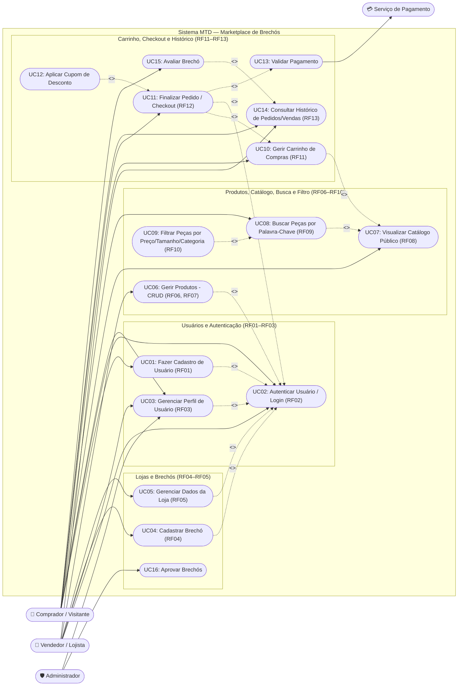

# Casos de Uso — Marketplace de Brechós

## 1. Visão Geral

O **Marketplace de Brechós** é uma plataforma digital destinada à divulgação e comercialização de peças de vestuário de segunda mão (desapego), aproximando compradores e vendedores/brechós em um ambiente centralizado.

Conforme especificado em [requisitos-funcionais.md](file:///home/lucas/MTD-marketplace-brechos/docs/requisitos/requisitos-funcionais.md) (**RF01 a RF13**), todo usuário cadastrado possui um **Perfil Único de Conta**, podendo atuar simultaneamente como **Comprador** e como **Vendedor (Lojista)** sem necessidade de contas separadas, além do papel de **Administrador** para moderação da plataforma.

---

## 2. Matriz de Rastreabilidade (Requisitos Funcionais × Casos de Uso)

A tabela abaixo garante que **todos os 13 Requisitos Funcionais (RF01–RF13)** definidos no projeto estão contemplados nos casos de uso e no diagrama:

| Requisito Funcional | Título do RF | Caso(s) de Uso Associado(s) | Ator Principal |
|---|---|---|---|
| **RF01** | Cadastro de Usuários (Perfil Único e E-mail Único) | **UC01** — Fazer Cadastro de Usuário | Visitante / Usuário |
| **RF02** | Autenticação de Usuários (Login) | **UC02** — Autenticar Usuário (Fazer Login) | Usuário (Comprador / Vendedor) |
| **RF03** | Gerenciamento de Perfil (Consulta, Edição e Exclusão) | **UC03** — Gerenciar Perfil de Usuário | Usuário Autenticado |
| **RF04** | Cadastro de Brechó | **UC04** — Cadastrar Brechó | Vendedor |
| **RF05** | Gerenciamento da Loja / Vitrine do Brechó | **UC05** — Gerenciar Dados da Loja | Vendedor |
| **RF06** | Cadastro de Peças/Produtos | **UC06** — Gerir Produtos (Cadastrar Produto) | Vendedor |
| **RF07** | Atualização e Remoção de Produtos | **UC06** — Gerir Produtos (Alterar / Remover Produto) | Vendedor |
| **RF08** | Visualização do Catálogo Público (Vitrine) | **UC07** — Visualizar Catálogo Público | Visitante / Comprador |
| **RF09** | Pesquisa de Produtos por Palavras-Chave | **UC08** — Buscar Peças por Palavra-Chave | Comprador |
| **RF10** | Filtragem de Itens (Preço, Tamanho, Categoria, Brechó) | **UC09** — Filtrar Peças | Comprador |
| **RF11** | Gestão do Carrinho de Compras (Adicionar/Remover) | **UC10** — Gerir Carrinho de Compras | Comprador |
| **RF12** | Finalização de Pedido (Checkout) | **UC11** — Finalizar Pedido (Checkout) **UC12** — Aplicar Cupom de Desconto **UC13** — Validar Pagamento | Comprador / Serviço de Pagamento |
| **RF13** | Histórico e Status de Pedidos | **UC14** — Consultar Histórico de Pedidos e Vendas **UC15** — Avaliar Brechó | Comprador / Vendedor |

---

## 3. Diagrama de Casos de Uso (Contemplando Todos os RFs — RF01 a RF13)

O diagrama abaixo representa visualmente todos os casos de uso do sistema mapeados diretamente aos requisitos **RF01–RF13** e seus relacionamentos (`<<include>>` e `<<extend>>`):

---

## 4. Descrição Detalhada dos 3 Casos de Uso Mais Relevantes

A seguir estão detalhados os **3 casos de uso mais relevantes** para a arquitetura e regras de negócio do projeto até a **Sprint 3**, abrangendo fluxos principais, fluxos alternativos, fluxos de exceção, pré/pós-condições e regras de negócio.

---

### 4.1 Caso de Uso Relevante 1: UC01 — Cadastrar e Gerenciar Usuário (CRUD de Usuário)

* **Requisitos Relacionados:** **RF01** (Cadastro de Usuários), **RF02** (Autenticação), **RF03** (Gerenciamento de Perfil), **RNF01** (Persistência RAM/SQLite) e **RNF02** (Validação de Dados).
* **Ator Principal:** Visitante / Usuário (Perfil Único Comprador e Vendedor).
* **Classes de Análise Envolvidas:** `Main` (`<<Fronteira>>`), `FacadeSingletonController`, `UsuarioService`, `UsuarioValidator` (`<<Controle>>`), `UsuarioRepository`, `UsuarioRepositoryRam`, `UsuarioRepositorySQLite` (`<<Fronteira>>`) e `Usuario` (`<<Entidade>>`).
* **Objetivo:** Permitir o ciclo completo de registro, consulta, atualização cadastral e remoção de usuários na plataforma, garantindo integridade de nome, e-mail e senha.
* **Pré-condições:**
  * O sistema está inicializado com o motor de persistência configurado (`RAM` ou `SQLite`).
  * Para criação: o e-mail informado ainda não está vinculado a outra conta.
* **Pós-condições:**
  * **Sucesso:** O usuário é persistido/atualizado no repositório ativo com perfil unificado (habilitado tanto para comprar quanto para anunciar produtos), incrementando a contagem total de entidades gerenciada pela fachada (`FacadeSingletonController`).
  * **Falha:** Nenhuma alteração indevida é gravada e o sistema lança exceção de validação ou de banco de dados informando o motivo exato.

#### Fluxo Principal (Cadastro de Novo Usuário — Caminho Feliz)
1. O usuário solicita o cadastro informando `nome`, `email` e `senha`.
2. A camada de apresentação (`Main`) encaminha a solicitação para `FacadeSingletonController.adicionarUsuario(usuario)`.
3. O controlador delega a operação para `UsuarioService`.
4. O `UsuarioService` aciona `UsuarioValidator.validarNome(nome)`:
   * Verifica que o nome não é nulo nem vazio (`isBlank()`).
   * Verifica que o nome possui no máximo 12 caracteres (`NOME_MAXIMO_CARACTERES = 12`).
   * Verifica que o nome não contém dígitos numéricos.
5. O `UsuarioService` aciona `UsuarioValidator.validarSenha(senha, nome, email)`:
   * Verifica que a senha não é vazia e possui entre 8 e 128 caracteres.
   * Verifica que a senha combina ao menos **3 de 4 categorias** de caracteres (letras maiúsculas, letras minúsculas, números e caracteres especiais).
   * Verifica que a senha não é idêntica ao `nome` nem ao `email` (ignorando maiúsculas/minúsculas).
6. O `UsuarioService` verifica a unicidade e solicita a gravação em `UsuarioRepository`.
7. O repositório (`UsuarioRepositoryRam` ou `UsuarioRepositorySQLite`) armazena a entidade `Usuario`.
8. O sistema confirma o cadastro do usuário com sucesso.

#### Fluxos Alternativos (Consulta, Atualização e Exclusão — RF03)
* **FA01 — Consultar / Listar Usuários:** O ator solicita a listagem ou busca por ID via `FacadeSingletonController`, que retorna os registros armazenados no repositório ativo.
* **FA02 — Atualizar Dados do Perfil (RF03):** O usuário autenticado altera seu `nome` ou `email` via `FacadeSingletonController.atualizarUsuario(usuario)`. O `UsuarioValidator` revalida os campos antes de persistir a atualização no repositório.
* **FA03 — Remover Usuário:** O usuário ou administrador solicita a exclusão do registro pelo `id` via `FacadeSingletonController.deletarUsuario(id)`.

#### Fluxos de Exceção
* **FE01 — Nome Inválido (Vazio, > 12 caracteres ou com Números):** No passo 4, o `UsuarioValidator` interrompe o fluxo e lança exceção informando a regra violada (`"O nome nao pode ser vazio."`, `"O nome nao pode ter mais de 12 caracteres."` ou `"O nome nao pode conter numeros."`).
* **FE02 — Senha Fraca ou Idêntica ao Nome/E-mail:** No passo 5, o `UsuarioValidator` rejeita a senha e lança exceção detalhando o requisito de segurança não atendido.
* **FE03 — Falha de Persistência SQLite:** No passo 7, caso ocorra erro de I/O ou restrição de chave no SQLite, a `SQLException` é capturada e encapsulada em `DatabaseOperationException`.

---

### 4.2 Caso de Uso Relevante 2: UC06 — Gerir Peças/Produtos no Catálogo (CRUD de Produto)

* **Requisitos Relacionados:** **RF06** (Cadastro de Peças/Produtos), **RF07** (Atualização e Remoção de Produtos), **RF08** (Visualização do Catálogo), **RNF01** (Persistência Plugável RAM/SQLite) e **RNF02** (Validação de Dados).
* **Ator Principal:** Vendedor / Lojista (e Comprador na consulta da vitrine).
* **Classes de Análise Envolvidas:** `Main` (`<<Fronteira>>`), `FacadeSingletonController`, `ProdutoService`, `ProdutoValidator`, `ValidationException` (`<<Controle>>`), `ProdutoRepository`, `ProdutoRepositoryRAM`, `ProdutoRepositorySQLite`, `DatabaseOperationException` (`<<Fronteira>>`) e `Produto` (`<<Entidade>>`).
* **Objetivo:** Permitir que o vendedor cadastre novas peças de brechó, consulte detalhes por ID, liste todos os itens da vitrine, atualize preços/descrições e remova peças vendidas ou indisponíveis.
* **Pré-condições:**
  * O vendedor está associado a um `usuarioId` válido no sistema.
* **Pós-condições:**
  * **Sucesso:** O produto é criado, atualizado ou removido no repositório ativo (`ConcurrentHashMap` em RAM ou tabela `produtos` no SQLite) e a métrica `getQuantidadeTotalEntidadesCadastradas()` reflete imediatamente a operação.
  * **Falha:** O cadastro/edição é bloqueado por `ValidationException` ou `DatabaseOperationException`.

#### Fluxo Principal (Cadastro de Produto — RF06)
1. O vendedor informa os dados da peça: `titulo`, `descricao`, `preco` (`BigDecimal`), `tamanho` e `usuarioId`.
2. A fronteira aciona `FacadeSingletonController.cadastrarProduto(produto)`.
3. A fachada delega a chamada para `ProdutoService.cadastrarProduto(produto)`.
4. O `ProdutoService` aciona `ProdutoValidator.validar(produto)`:
   * Verifica se a referência de `produto` não é nula.
   * Valida se `titulo` não é nulo nem está em branco (`validarTitulo`).
   * Valida se `preco` não é nulo e é estritamente maior que zero (`preco.compareTo(BigDecimal.ZERO) > 0` em `validarPreco`).
5. O `ProdutoService` invoca `ProdutoRepository.salvar(produto)`.
6. Se o modo for `RAM` (`ProdutoRepositoryRAM`), um ID sequencial `Long` é gerado via `AtomicLong` (caso nulo) e o produto é inserido no `ConcurrentHashMap<Long, Produto>`. Se o modo for `BD` (`ProdutoRepositorySQLite`), um `PreparedStatement` insere o registro na tabela `produtos` e recupera a chave gerada.
7. O produto salvo é retornado com seu `id` preenchido.

#### Fluxos Alternativos (Consulta, Edição e Remoção — RF07 e RF08)
* **FA01 — Visualizar Catálogo Completo (RF08):** Qualquer usuário aciona `FacadeSingletonController.listarTodosProdutos()`, retornando todos os produtos disponíveis na vitrine.
* **FA02 — Consultar Produto por ID:** O usuário busca uma peça específica via `FacadeSingletonController.buscarProdutoPorId(id)`, recebendo um `Optional<Produto>`.
* **FA03 — Atualizar Produto (RF07):** O vendedor altera dados da peça (ex.: redução de preço ou ajuste de descrição/tamanho) e aciona `FacadeSingletonController.atualizarProduto(produto)`. O `ProdutoValidator` revalida título e preço antes de atualizar no repositório.
* **FA04 — Remover Produto do Catálogo (RF07):** Quando a peça é vendida ou retirada, o vendedor aciona `FacadeSingletonController.deletarProduto(id)`, removendo-a da vitrine ativa.

#### Fluxos de Exceção
* **FE01 — Título Vazio ou Nulo:** No passo 4, `ProdutoValidator` lança `ValidationException("O titulo do produto nao pode ser vazio.")`.
* **FE02 — Preço Zero, Negativo ou Nulo:** No passo 4, `ProdutoValidator` lança `ValidationException("O preco do produto deve ser maior que zero.")`.
* **FE03 — Erro no Banco SQLite:** Qualquer `SQLException` lançada durante `salvar`, `buscarPorId`, `listarTodos`, `atualizar`, `deletar` ou `contar` em `ProdutoRepositorySQLite` é capturada e relançada encapsulada em `DatabaseOperationException`.

---

### 4.3 Caso de Uso Relevante 3: UC11 — Finalizar Pedido / Checkout a partir do Carrinho

* **Requisitos Relacionados:** **RF11** (Gestão do Carrinho de Compras), **RF12** (Finalização de Pedido / Checkout), **RF13** (Histórico de Pedidos) e **RNF06** (Integridade e Imutabilidade de Pedidos).
* **Atores:** Comprador (principal), Vendedor/Brechó (secundário) e Serviço de Pagamento (externo).
* **Objetivo:** Processar a compra das peças selecionadas no carrinho do comprador, validar o pagamento, registrar o pedido de forma imutável e disponibilizá-lo no histórico do comprador e na fila do brechó vendedor.
* **Pré-condições:**
  * O comprador está autenticado no sistema (**UC02**).
  * O carrinho de compras possui ao menos um `Produto` disponível em estoque (**UC10**).
* **Pós-condições:**
  * **Sucesso:** O pedido é registrado com status atualizado, os itens e valores unitários tornam-se imutáveis (**RNF06**), o carrinho é esvaziado e a venda passa a constar no histórico do comprador e do vendedor (**RF13**).
  * **Falha:** O pedido não é efetivado e os itens permanecem no carrinho do comprador.

#### Fluxo Principal (Checkout com Sucesso — RF11, RF12, RF13)
1. O comprador autenticado revisa os itens adicionados ao seu carrinho de compras (**UC10**).
2. O sistema calcula e apresenta o valor subtotal dos itens selecionados.
3. O comprador confirma os dados de entrega e a forma de pagamento e solicita a finalização do pedido.
4. O sistema executa o caso de uso incluído **UC13 — Validar Pagamento** junto ao serviço de pagamento.
5. O serviço de pagamento confirma a aprovação da transação.
6. O sistema gera o registro imutável do pedido (**RNF06**), vinculando o comprador, os itens com seus preços praticados no ato da compra e o brechó de origem.
7. O sistema limpa o carrinho de compras do comprador e atualiza a disponibilidade das peças no catálogo.
8. O sistema apresenta a confirmação do pedido e o disponibiliza para consulta em **UC14 — Consultar Histórico de Pedidos/Vendas** (**RF13**).

#### Fluxos Alternativos
* **FA01 — Aplicar Cupom de Desconto (`<<extend>>` UC12):** Antes de confirmar o pagamento (passo 2), o comprador informa um código de cupom. O sistema valida sua vigência e recalcula o valor total do pedido com o desconto aplicado.

#### Fluxos de Exceção
* **FE01 — Pagamento Recusado:** No passo 5, se o serviço de pagamento recusar a transação, o sistema exibe mensagem de erro, mantém o pedido como pendente/cancelado e preserva os itens no carrinho para nova tentativa.
* **FE02 — Peça Indisponível no Momento do Checkout:** Caso outro comprador tenha finalizado a compra da mesma peça única instantes antes, o sistema alerta sobre a indisponibilidade do item e solicita a revisão do carrinho.

---

## 5. Resumo Geral de Todos os Casos de Uso (UC01 a UC16)

| ID | Caso de Uso | Atores | RFs Atendidos | Relacionamentos |
|---|---|---|---|---|
| **UC01** | Fazer Cadastro de Usuário | Visitante / Comprador / Vendedor | RF01 | `<<extend>>` UC02 |
| **UC02** | Autenticar Usuário (Fazer Login) | Comprador, Vendedor | RF02 | Incluído por UC03, UC04, UC05, UC06, UC11 |
| **UC03** | Gerenciar Perfil de Usuário | Comprador, Vendedor, Admin | RF03 | `<<include>>` UC02 |
| **UC04** | Cadastrar Brechó | Vendedor | RF04 | `<<include>>` UC02 |
| **UC05** | Gerenciar Dados da Loja | Vendedor | RF05 | `<<include>>` UC02 |
| **UC06** | Gerir Produtos (CRUD Completo) | Vendedor | RF06, RF07 | `<<include>>` UC02 |
| **UC07** | Visualizar Catálogo Público (Vitrine) | Visitante, Comprador | RF08 | Base para UC08 e UC10 |
| **UC08** | Buscar Peças por Palavra-Chave | Comprador | RF09 | `<<extend>>` UC07 |
| **UC09** | Filtrar Peças (Preço, Tamanho, Categoria, Brechó) | Comprador | RF10 | `<<extend>>` UC08 |
| **UC10** | Gerir Carrinho de Compras | Comprador | RF11 | `<<include>>` UC07 |
| **UC11** | Finalizar Pedido (Checkout) | Comprador | RF12 | `<<include>>` UC02, UC10, UC13 |
| **UC12** | Aplicar Cupom de Desconto | Comprador | RF12 | `<<extend>>` UC11 |
| **UC13** | Validar Pagamento | Sistema / Serviço de Pagamento | RF12 | Incluído por UC11 |
| **UC14** | Consultar Histórico de Pedidos e Vendas | Comprador, Vendedor | RF13 | Base para UC15 |
| **UC15** | Avaliar Brechó | Comprador | RF13 | `<<extend>>` UC14 |
| **UC16** | Aprovar Brechós | Administrador | RF04 | Moderação administrativa |
